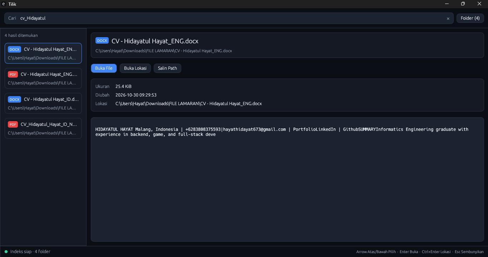

# Tilik — Windows desktop search

**Fast, lightweight, and local-first desktop search for Windows 11.**

Tilik is a Windows desktop search application built with Rust, designed to help you find files instantly across your configured folders. It combines filename and full-text search with incremental indexing, real-time file monitoring, and a keyboard-first interface.

Everything runs locally on your machine, providing a fast and private search experience without relying on cloud services.

<p align="center">
  
</p>

<p align="center">
  
  
  
  
</p>

---

## ✨ Features

### 🔎 Fast & Comprehensive Search

- **Filename Search** — Find files by name across all configured directories.
- **Full-Text Search** — Search inside document contents, source code, and supported file formats.
- **Document Snippets** — Preview relevant content directly from search results.
- **Multiple File Formats** — Supports `.txt`, `.md`, `.json`, `.csv`, source code, `.pdf`, `.docx`, and `.xlsx`.

### ⚡ Intelligent Indexing

- **Incremental Indexing** — Only new and modified files are re-indexed.
- **Real-Time File Monitoring** — Automatically detects filesystem changes through a file watcher.
- **Persistent Index** — Stores the search index locally for faster subsequent searches.

### ⌨️ Keyboard-First Experience

- Global hotkey to open or hide the search window from anywhere.
- Live search results as you type.
- Full keyboard navigation.
- `Enter` to open the selected file.
- `Ctrl + Enter` to reveal the file in Windows Explorer.
- `Esc` to hide the search window.

### 🖥️ Windows Integration

- **Global Hotkey** — Quickly access search without switching applications.
- **System Tray** — Manage Tilik through the Windows notification area.
- **Background Operation** — Closing the window hides Tilik to the system tray without stopping the indexer.
- **Startup Integration** — Option to launch Tilik automatically when Windows starts.
- **Single Instance** — Uses a Windows mutex to prevent multiple application instances.

---

## 🚀 Getting Started

### Download

Prebuilt Windows binaries are available on the [GitHub Releases](../../releases) page.

**Portable Version**

1. Download `tilik-win-rs-portable.zip` from the latest release.
2. Extract the archive to your preferred directory.
3. Run `tilik-ui.exe`.

No installation process is required.

### Default Hotkey

| Shortcut | Action |
|---|---|
| `Ctrl + Alt + F` | Toggle search window |
| `Up / Down` | Navigate search results |
| `Enter` | Open selected file |
| `Ctrl + Enter` | Reveal file in Explorer |
| `Esc` | Hide search window |

The global hotkey is configurable through the application configuration file.

> **Note:** `Alt + Space` is also supported but is not enabled by default because it may conflict with Windows system menus or third-party launchers such as PowerToys Run.

---

## ⚙️ Configuration

Tilik stores its configuration and search index in the Windows application data directory.

| Resource | Location |
|---|---|
| Configuration | `%APPDATA%\localsearch-win\config.toml` |
| Search Index | `%APPDATA%\localsearch-win\index\` |
| Index Manifest | `%APPDATA%\localsearch-win\index\manifest.toml` |

The configuration file allows you to customize application settings, including the global hotkey and indexed directories.

---

## 🛠️ Build from Source

### Prerequisites

- Windows 11
- [Rust Toolchain](https://www.rust-lang.org/tools/install)
- `stable` Rust toolchain
- `x86_64-pc-windows-msvc` target
- Microsoft C++ Build Tools (MSVC)

### Clone the Repository

```powershell
git clone https://github.com/Hdytalhayat/tilik-win-rs.git
cd tilik-win-rs
```

### Build & Run

Build the application in release mode:

```powershell
cargo build --release
```

Run the application:

```powershell
.\target\release\tilik-ui.exe
```

### Create a Release Package

To generate the portable release package locally:

```powershell
.\scripts\build-release.ps1
```

The generated package can then be uploaded to GitHub Releases.

---

## 🤖 AI-Assisted Development

Tilik is developed with assistance from **[OpenCode](https://opencode.ai/)**, using repository-specific development guidelines defined in [`AGENTS.md`](./AGENTS.md).

AI-assisted development follows a structured workflow to maintain code quality, consistency, and reliability.

### Development Principles

1. **Explore Before Implementing** — Inspect relevant modules, dependencies, and existing implementations before making changes.
2. **Plan Before Execution** — Establish a clear, step-by-step implementation plan before modifying code.
3. **Minimal & Targeted Changes** — Keep changes focused and avoid unnecessary modifications to unrelated components.
4. **Non-Interactive Execution** — Use non-interactive CLI and Cargo commands to ensure predictable execution.
5. **Evidence-Based Verification** — Validate changes using appropriate checks such as `cargo check`, `cargo build`, and `cargo test`. Review actual command output before considering a task complete.
6. **Controlled Retry Strategy** — Limit repeated attempts to three per approach. Investigate the root cause rather than repeatedly applying ineffective fixes.
7. **Regression & Edge-Case Review** — Evaluate potential regressions involving file access, file locks, encoding issues, filesystem events, and global hotkey conflicts.

The goal is to use AI as a development assistant while keeping implementation decisions, verification, and code quality under explicit engineering guidelines.

---

## 📁 Project Structure

Tilik follows a modular Rust workspace structure, separating its core search engine from the desktop user interface and release tooling.

```text
tilik/
├── core/                       # Core search engine and indexing logic
│   ├── src/
│   │   ├── config.rs           # Application configuration
│   │   ├── error.rs            # Core error handling
│   │   ├── extractor.rs        # File content extraction
│   │   ├── indexer.rs          # File indexing and index management
│   │   ├── lib.rs              # Core library entry point
│   │   ├── searcher.rs         # Filename and full-text search
│   │   └── watcher.rs          # Real-time filesystem monitoring
│   ├── tests/
│   │   ├── indexer.rs          # Indexing integration tests
│   │   └── perf.rs             # Performance tests
│   └── Cargo.toml
│
├── ui/                         # Desktop application interface
│   ├── assets/
│   │   └── tilik.ico           # Application icon
│   ├── src/
│   │   ├── platform/
│   │   │   ├── mod.rs          # Platform-specific modules
│   │   │   └── windows.rs      # Windows integration
│   │   └── main.rs             # Application entry point
│   ├── build.rs                # Build-time configuration
│   └── Cargo.toml
│
├── installer/
│   └── setup.iss               # Windows installer definition (Inno Setup)
│
├── scripts/
│   └── build-release.ps1       # Release packaging script
│
├── AGENTS.md                  # AI-assisted development guidelines
├── Cargo.toml                 # Workspace configuration
├── Cargo.lock                 # Dependency lockfile
├── LICENSE                    # MIT License
├── README.md                  # Project documentation
└── Tilik-Preview.png          # Application screenshot
```

### Architecture Overview

| Component | Responsibility |
|---|---|
| `core` | Handles configuration, file extraction, indexing, searching, and filesystem monitoring. |
| `ui` | Provides the desktop interface and Windows-specific application integration. |
| `installer` | Defines the Windows installation package using Inno Setup. |
| `scripts` | Automates release builds and portable package generation. |

The separation between `core` and `ui` keeps the search engine independent of the desktop presentation layer, making the codebase easier to maintain, test, and extend.

---

## 📄 License

Tilik is open-source software distributed under the **MIT License**.

See the [`LICENSE`](./LICENSE) file for more information.

---

<p align="center">
  <sub>Built with Rust 🦀 for a faster Windows search experience.</sub>
</p>
